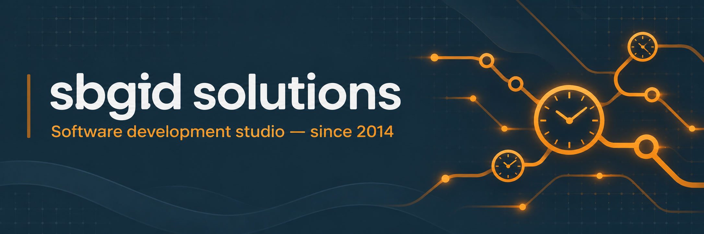
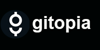
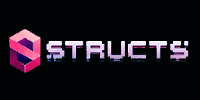
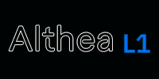
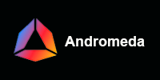
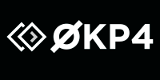
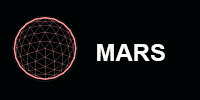
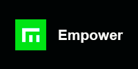

  

We build websites, mobile apps, backend systems, messaging bots and AI-powered
automation — for businesses worldwide.

## What we build

| | |
|---|---|
|  | **Websites & web apps** — landing pages, e-commerce, custom web applications |
|  | **Mobile apps** — customer apps, business tools, API integrations |
|  | **Bots & integrations** — Telegram bots & mini apps, order processing, support |
|  | **AI & automation** — AI assistants, workflow automation, document processing |
|  | **Backend & APIs** — backend systems, databases, integrations |

## Open source

| Project | What it does |
|---|---|
| [**Git-Chronos**](https://github.com/KokosP/git-chronos) | Local-first CLI that turns git commit history into billable hours and styled Excel invoices — `pip install git-chronos` |

## Stack

Python · PHP · C# · Kotlin · JavaScript · MySQL

## Validator infrastructure

We also operate 24/7 validator nodes on European servers:
Forta · Gitopia · Lambda · KYVE · ZetaChain · Massa · Nibiru · Evmos · Entangle —
plus testnets (Arkeo, Structs, Althea, Starknet, Near, Lava, Andromeda and more).

<b>Full validator list</b>

 

          

    

   

         

---

  <a href="https://sbgid.com">sbgid.com</a> ·
  <a href="https://t.me/Develcode">@Develcode</a> ·
  <a href="mailto:contact@sbgid.com">contact@sbgid.com</a> · Serbia

